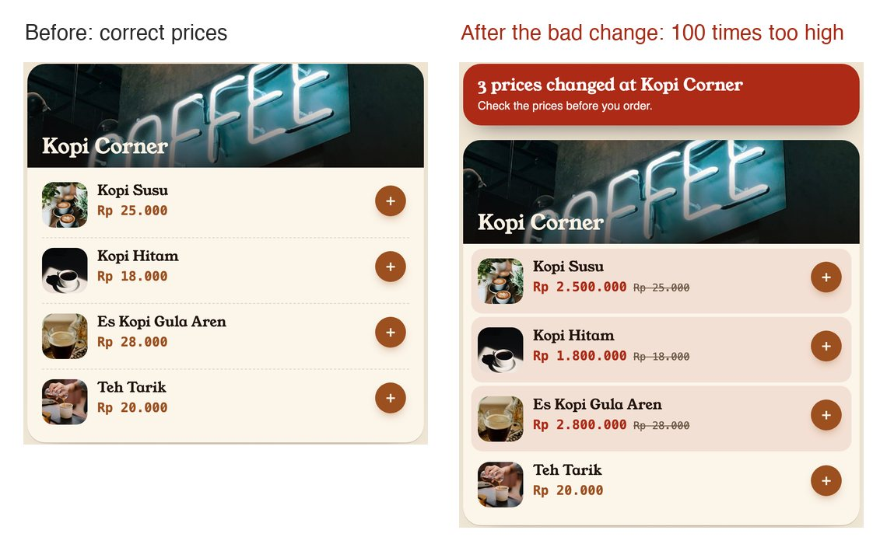

# Safe AI agents on AWS

Would you let an AI agent near your production data? Three questions decide it:

1. **Can it touch my data?**
2. **What did it actually do?**
3. **Can I get back?**

This demo answers all three in your own AWS account, in seven short steps and about 20 minutes.
The last step removes it.

## The story

Kopi Kiosk is a made-up coffee shop website with two menus, Kopi Corner and Kopi Seduh, priced in Indonesian rupiah. An
approved change goes wrong, and three prices on Kopi Corner jump 100 times. An AI agent investigates, but it has no way
to change anything. It tells you what it found, and you approve the fix.



## Before you start

**Use a test AWS account, never one that holds real work.** A full run should cost a few cents to a few tens of cents,
as long as you finish step 7.

You need:

- **AWS sign-in in your terminal,** with administrator rights. Any usual way works: a profile, SSO or access keys.
- **[uv](https://docs.astral.sh/uv/getting-started/installation/),** which runs `./kopi` and installs its Python packages.
- **[Terraform](https://developer.hashicorp.com/terraform/install) 1.10 or newer,** which builds the AWS resources.
  You don't need to know it. `./kopi` runs it for you.
- **Access to Claude in Amazon Bedrock,** the AWS service that offers Claude, the model the agent runs on. New to it?
  Anthropic asks for a [use case form](https://docs.aws.amazon.com/bedrock/latest/userguide/model-access.html) once per
  account. Open the [Bedrock console in Sydney](https://ap-southeast-2.console.aws.amazon.com/bedrock/home?region=ap-southeast-2),
  pick any Claude model in the model catalog, and submit it. Access usually follows straight away.

Step 2 checks your sign-in, Terraform and Claude access before it creates anything, and says what to fix. It runs in
`ap-southeast-2`, whatever region your terminal uses. macOS is tested. Linux should work, but is untested.

## Run it

Run these in order. **Lost at any point? Run `./kopi`.** It tells you where you are and what to run next.

### 1. Get the code

```
git clone https://github.com/ntcsteve/safe-ai-agents-aws.git
cd safe-ai-agents-aws
```

### 2. Deploy

```
./kopi up
```

It shows the AWS account it will use, then Terraform's plan of what it will create. Make sure that is your test
account, then type `yes`. The plan shows your account ID, so don't share your screen. This takes about 5 minutes.

**Success: `HEALTHY` and a web address.** Open it, on a phone if you can, and leave it open. Every price is correct. You
can add something to your order, so you can watch the total jump in step 4, but you don't have to.

### 3. Can it touch my data?

```
./kopi safe
```

AWS's own permission checker tests each IAM role (a set of permissions) that the agent can reach.

**Success: `BOUNDARY HOLDS`.** Nothing in the agent's path can write. This checks the roles' own policies. It does not
cover organization-wide policies.

### 4. Break it

```
./kopi break
```

This applies a change called `MNT-142`: approved, and wrong.

**Success: `BROKEN`.** Within seconds, the open page updates by itself and shows three prices 100 times too high. A
clock starts against a 10-minute target, called the tolerance. Going over it only changes that message to `OVER`. In the
output, a stall just means one menu.

### 5. What did it actually do?

```
./kopi observe
```

The agent reports what it found, what it thinks happened, what it could not see, and how it would recover. Then come
its receipts: a log line written by each tool it used, which the agent cannot edit. So you can check what it did, not
only what it said.

**Success: `S3 version IDs match before and after, so it changed nothing`.** The menus live in S3, which gives every
change a new version ID. So this comes from AWS, not from the agent.

### 6. Can I get back?

```
./kopi recover
```

It shows the one menu it would restore. Type `ROLL BACK` to approve, or anything else to stop.

**Success: `RECOVERED`.** Kopi Corner's prices are correct again, and Kopi Seduh still has its 20% off promo
(`PROMO-7`). That proves the restore touched only one menu.

Want to go round again? Run `./kopi reset`, then start from step 4.

### 7. Clean up

**Don't skip this. The demo costs money until you do.**

```
./kopi down
```

Type `yes`. This takes 4 to 6 minutes. Keep this folder until it finishes, because `infra/terraform.tfstate` is the only
record of what to remove.

**Success: `DOWN`.** Run `./kopi` to confirm. It says `NOT DEPLOYED`.

## If you get stuck

Every message names what happened and what to run next, so start there. Then run `./kopi`. These are the exceptions:

| You see | It means | Do this |
|---|---|---|
| `uv: No such file or directory` | uv is not installed | Install it, then open a new terminal |
| `PREFLIGHT FAILED` | Sign-in, Terraform or Claude access is missing. Nothing was created | Follow its `Next:` |
| `TERRAFORM FAILED` during `down` | Usually a scenario file you edited is not valid JSON | Fix the file, then `./kopi down` |

## What this leaves out

This is a learning demo, not a production pattern. Now that you have seen it, here is what production also needs:

- The agent runs in public network mode, not inside your VPC.
- Data is not encrypted with your own KMS key.
- CloudTrail data events are off, so S3 reads are not audited separately.
- Receipts are matched to tool calls by time and tool name, not by a correlation ID.
- The menu page is public to anyone with its web address.
- Your terminal holds write access. The agent never gets those credentials.

**S3 versions alone are not enough either.** `./kopi recover` restores from S3 versions, which is simple and works here.
But those versions live in the same bucket and the same account as the data. Anyone with delete rights can remove them,
so this protects you from a bad change, not from a stolen credential or a deleted bucket.

## Go further

The optional [Clumio add-on](addons/clumio/README.md) adds a managed way back, using Backtrack from Clumio, a cloud
backup service. Backtrack uses the same S3 versions, so it does not solve the problem above. Its daily copy outside
your account does, and this demo never restores from that copy. For real data, see
[Get started with Clumio on AWS](https://github.com/ntcsteve/get-started-clumio-aws).

## How it works

AgentCore is the AWS service that runs the agent.

```
You (terminal)                        Customers (browser)
   |                                        ^
   | break / recover / reset                | reads the menu
   | (only you can write)                   |
   v                                        |
S3 bucket, versioned  ---------------> CloudFront
   ^   menus/stall-kopi.json    <- gets broken
   |   menus/stall-seduh.json   <- must stay untouched
   | read only
Lambda (2 tools, each logs a receipt)
   ^
AgentCore Gateway (passes the agent's tool calls to Lambda)
   ^
AgentCore agent, running Claude: investigates, can never write
```

```
scenario/kopi.json   the story: menus, the bad change, the good change, the tolerance
config.env           where it runs: region, model, scenario
kopi                 the one command
kiosk/               the logic. states.py is what each command may do, and commands.py is each step
infra/               AWS, in Terraform. investigator-prompt.md is the agent's instructions
site/                the menu page
addons/clumio/       optional. Everything Clumio. Run ./kopi down before you delete it
tests/               what ./check runs
```

## Change it

There is one rule: **edit a file, then run `./kopi up`.** Until you do, other commands refuse and say what changed.

| To change | Edit | Then |
|---|---|---|
| The story: menus, prices, the bad change, the tolerance | `scenario/kopi.json`, or a new file there | `./kopi up` |
| The region or model | `config.env` | For a new region, `./kopi down` first. Then `./kopi up` |
| The agent's instructions | `infra/investigator-prompt.md` | `./kopi up`, then `./kopi eval` |

Only `ap-southeast-2` has been tested. Another region needs AgentCore and a Claude inference profile there.

`./kopi eval` makes three checks, mainly on what AWS shows: nothing may change in S3, and an answer about a broken menu
must name the real version IDs. It cannot prove an answer is honest. It would not catch an agent claiming a fix it
never made, though S3 would still show that nothing changed.

`./check` runs every test and Terraform check. It changes nothing in AWS, and it also needs Node 20 or newer.

## Status and license

Last tested on 1 November 2026 on macOS, in one AWS account, in `ap-southeast-2`, with Terraform 1.15, AWS provider
6.70.0 and `au.anthropic.claude-sonnet-4-6`. That covered all seven steps, the Clumio add-on's connect and rollback,
and removal, including after a connect that stopped partway. It has never been tested in a brand-new account.

A blank `CLUMIO_OU_ID` and the `CLUMIO POINT BAD` refusal have only been tested in code.

This is a personal learning project, offered as is, with no support. It is not an official AWS or Commvault
product. Apache-2.0: see [LICENSE](LICENSE). Photos and font keep their own licences: see
[site/img/CREDITS.md](site/img/CREDITS.md).
